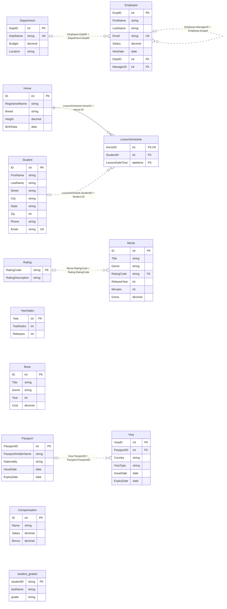

# D427 Data Management – Applications: MySQL Practice Kit

Hands-on SQL practice for WGU **D427 Data Management – Applications**, run against a real MySQL 8.4 server, either in a Docker container or installed on your computer.

Read the exercises online at **[jeubanks.github.io/wgu](https://jeubanks.github.io/wgu/d427/exercises/)**.

151 exercises cover the D427 skills: querying, built-in functions, aggregation, joins, subqueries, inserting/updating/deleting data, creating and altering tables with constraints, views, indexes, and turning a design into tables.

Sections 11–13 are built from the two D427 practice tests and the D427 Challenge (in your WGU course resources; not included here). They cover writing tables from the practice tests' column descriptions, their join wording ("if available", "regardless of"), and a multiple-choice concepts check. The final section is a 12-task practice set on the riding-stable tables (Horse / Student / LessonSchedule).

## What's in this folder

| File | Purpose |
|---|---|
| `README.md` | This file (the **Setup** page on the website): setup, how to work through the exercises, troubleshooting. |
| <a href="setup.sql" download>`setup.sql`</a> | Builds the `d427` database and loads the sample data. Re-run it any time to reset. |
| `exercises.md` | Start here: the table of contents, the order to work in, and a summary of the tables. |
| `01-queries.md` … `05-final-practice.md` | The exercises, in five parts. Most exercises list the expected row count so you can check yourself. Part 4 (concepts check) has its answers folded under each question. |
| `solutions.sql` | One worked answer per SQL exercise, labeled `-- [1.1]`, `-- [5.3]`, etc., with notes on the common traps. Section 13 has only its hints here. |
| `later-advanced-sql.md` | Exercises that go beyond D427: transactions, plus a few more advanced queries and views. Kept for a later SQL course. |
| `quick-reference.md` | The SQL quick reference: column specs, constraints, ALTER TABLE, joins, GROUP BY, views, and indexes on one printable page. |
| `drill.md` | The spec-to-type drill: random column specs to turn into MySQL types (interactive on the website; `docs/javascripts/drill.js`). |
| `errors.md`, `build_errors.py` | The MySQL error decoder. `build_errors.py` writes its entries from every `ERROR nnnn` in `solutions.sql` and the exercises; run it after adding one. |
| `build_solutions.py` | Copies each hint and answer from `solutions.sql` into the exercise files as folded **Hint** and **Solution** blocks. Run `python3 build_solutions.py` after changing `solutions.sql`. |
| `build_diagrams.py` | Draws the diagram of the practice database below from `setup.sql`. Run `python3 build_diagrams.py` after changing a table in `setup.sql`. |

## Setup

You need a MySQL 8.4 server and the <a href="setup.sql" download>`setup.sql`</a> file, which builds the practice database. There are three ways to get a server:

- **[Docker](#option-a-docker)** (recommended): nothing is installed on your computer except Docker, and you can remove it all with one command. The rest of this page uses this setup.
- **[MySQL on your computer](#option-b-mysql-installed-on-your-computer)**: install MySQL yourself if you already have it or prefer not to use Docker.
- **[Online, in your browser](#option-c-online-with-db-fiddle)**: nothing to install. A free website runs real MySQL for you. Handy on a work or school computer, or to get started right away.

Part 1, Section 7, and most of Section 12 also have **Try it** boxes on the site itself. Those run SQLite in your browser, not MySQL, so they're for practice only; everything else needs one of the three options.

### Option A: Docker

Requirements:

- Docker (Docker Desktop, Docker Engine, or Podman; see the Podman note below)
- About 600 MB of disk for the MySQL image
- Port 3306 free on your machine (only needed if you want to connect from a GUI tool)

The `mysql:8.4` image runs on both x86_64 and ARM64 (Apple Silicon). Run these commands from inside this folder.

#### 1. Pull the MySQL image

```bash
docker pull mysql:8.4
```

#### 2. Start the container

```bash
docker run -d --name d427 \
  -e MYSQL_ROOT_PASSWORD=d427pass \
  -p 3306:3306 \
  -v "$PWD":/work \
  mysql:8.4
```

- `--name d427` lets you refer to the container by name in the commands below.
- `MYSQL_ROOT_PASSWORD` sets the root password. It's a throwaway practice password; change it if you like and substitute it everywhere below.
- `-p 3306:3306` exposes MySQL to your machine for GUI clients.
- `-v "$PWD":/work` mounts this folder inside the container at `/work`, so the client can read `setup.sql` directly.

#### 3. Wait for MySQL to finish initializing

The first start takes 15–60 seconds. MySQL starts a temporary server during initialization, then restarts, so wait for the real one (the line that reports `port: 3306`):

```bash
until docker logs d427 2>&1 | grep -q "ready for connections.*port: 3306"; do sleep 2; done; echo "MySQL is ready"
```

#### 4. Load the practice database

```bash
docker exec -i -e MYSQL_PWD=d427pass d427 mysql -uroot < setup.sql
```

Passing the password through `MYSQL_PWD` avoids the "using a password on the command line is insecure" warning.

#### 5. Connect and check

```bash
docker exec -it -e MYSQL_PWD=d427pass d427 mysql -uroot d427
```

At the `mysql>` prompt:

```sql
SHOW TABLES;
SELECT COUNT(*) FROM Employee;   -- should return 15
```

You should see thirteen tables: `Book`, `Compensation`, `Department`, `Employee`, `Horse`, `LessonSchedule`, `Movie`, `Passport`, `Rating`, `Student`, `student_grades`, `Visa`, `YearSales`.

### Option B: MySQL installed on your computer

1. Download and install **MySQL Community Server 8.4 LTS** from [dev.mysql.com/downloads/mysql](https://dev.mysql.com/downloads/mysql/). On macOS you can also use `brew install mysql@8.4`. Remember the root password you set during install.
2. Optionally install [MySQL Workbench](https://dev.mysql.com/downloads/workbench/) if you'd rather work in a GUI than the command line.
3. Download <a href="setup.sql" download>`setup.sql`</a> and load it (Workbench: **File → Open SQL Script**, then run it):

    ```bash
    mysql -u root -p < setup.sql
    ```

4. Connect with `mysql -u root -p d427` and run the checks from step 5 above.

The commands in the rest of this page are for Docker. With a local install, use `mysql -u root -p` in place of `docker exec ... mysql -uroot`, and `SOURCE` the full path to your copy of `setup.sql`.

### Option C: Online, with DB Fiddle

[DB Fiddle](https://www.db-fiddle.com/) runs real MySQL 8.4 on its own server and shows the results in your browser. It's free, and you don't need an account.

1. Open [db-fiddle.com](https://www.db-fiddle.com/) and set **Database** (top left) to **MySQL v8**. It runs MySQL 8.4.
2. Open <a href="setup.sql">`setup.sql`</a> in a new tab, copy all of it, and paste it into **Schema SQL** (the left box). It works as is.
3. Type your statements into **Query SQL** (the right box) and press **Run**. Check that it works with `SELECT COUNT(*) FROM Employee;` (15).

How it differs from a server of your own:

- **Every Run starts over.** DB Fiddle rebuilds the database from Schema SQL each time, so nothing you change is kept. That makes resetting easy (just press Run), but for the sections that build on earlier exercises (7 to 10, and 14), keep the earlier exercises' statements in Query SQL above the new one, or move them to the end of Schema SQL.
- **Errors show MySQL's message but not its number.** Deleting a parent row that other rows still use, for example, shows just "Cannot delete or update a parent row: ...". The [error decoder](errors.md) matches messages too.
- **A failing statement hides the other results.** Run a statement that's meant to fail on its own.
- **Save** makes a public link that anyone who has it can open. You don't need to save to practice.
- `\G` and `SOURCE` are mysql-client commands, so they don't work here. Use `SHOW CREATE TABLE Employee;` with a semicolon.

DB Fiddle is a third-party website, not part of this kit, so it may change.

## Day-to-day use

| Task | Command |
|---|---|
| Open a SQL prompt | `docker exec -it -e MYSQL_PWD=d427pass d427 mysql -uroot d427` |
| Reset the data from inside the prompt | `SOURCE /work/setup.sql;` |
| Reset the data from your shell | `docker exec -i -e MYSQL_PWD=d427pass d427 mysql -uroot < setup.sql` |
| Run a whole file of your own answers | `docker exec -i -e MYSQL_PWD=d427pass d427 mysql -uroot -t d427 < my-answers.sql` |
| Stop the container (data is kept) | `docker stop d427` |
| Start it again | `docker start d427` |
| Remove it completely | `docker rm -f d427` |

Handy commands at the `mysql>` prompt:

- `DESCRIBE Employee;` shows a table's columns and types.
- `SHOW CREATE TABLE Employee\G` shows the full definition including constraints and foreign keys.
- Ending a query with `\G` instead of `;` prints each row vertically, which helps with wide results.
- `SHOW WARNINGS;` explains a statement that reported warnings.

### Connecting from a GUI (optional)

MySQL Workbench, DBeaver, DataGrip, or the VS Code MySQL extension can connect with:

- Host: `127.0.0.1` (use this rather than `localhost`, which some clients treat as a local socket)
- Port: `3306`
- User: `root`
- Password: `d427pass`
- Database: `d427`

### Podman

Every command above works with `podman` in place of `docker`. On SELinux systems (Fedora, RHEL, Rocky), add `:Z` to the volume so the container can read the folder: `-v "$PWD":/work:Z`.

## The practice database

`setup.sql` creates three small schemas in one database, plus six drill tables for Section 12. Run `DESCRIBE TableName;` or read `setup.sql` for each column's type and size.

<!-- er-diagram -->

<!-- /er-diagram -->

How to read the diagram: each box is a table, with one row per column: its name, a general type, and its keys. **PK** is the primary key, **FK** a foreign key, and **UK** a unique column. The types are general on purpose (Section 11 has you pick the exact MySQL types). Each line joins a foreign key to the column it references, so it shows how you would join the two tables. The ends of a line use crow's-foot notation. At the referenced table, two bars mean exactly one row, and a bar with a circle means zero or one row (the foreign key can be NULL). At the other end, a crow's foot with a circle means zero or more rows. A solid line means the foreign key is part of that table's primary key; a dashed line means it isn't. A table with no line has no foreign keys: Book.Year, for example, is not a foreign key to YearSales.

The same tables as text, with their delete rules, defaults, and CHECKs:

```
Department(DeptID PK, DeptName UNIQUE, Budget, Location)
Employee(EmpID PK AI, FirstName, LastName, Email UNIQUE, Salary, HireDate,
         DeptID FK->Department ON DELETE SET NULL, ManagerID FK->Employee)

Horse(ID PK AI, RegisteredName, Breed CHECK, Height CHECK, BirthDate CHECK)
Student(ID PK AI, FirstName, LastName, Street, City, State DEFAULT 'TX', Zip, Phone, Email UNIQUE)
LessonSchedule(HorseID FK->Horse ON DELETE CASCADE,
               StudentID FK->Student ON DELETE SET NULL,
               LessonDateTime,  PK(HorseID, LessonDateTime))

Rating(RatingCode PK, RatingDescription)
Movie(ID PK AI, Title, Genre, RatingCode FK->Rating, ReleaseYear, Minutes, Gross)

YearSales(Year PK, TotalSales, Releases)
Book(ID PK AI, Title, Genre, Year, Cost)
Passport(PassportID PK, PassportHolderName, Nationality, IssueDate, ExpiryDate)
Visa(VisaID PK, PassportID FK->Passport, Country, VisaType, IssueDate, ExpiryDate)
Compensation(ID PK, Name, Salary, Bonus)
student_grades(studentID PK, lastName, grade)
```

The data includes edge cases on purpose, because that's where SQL answers most often go wrong:

- an employee with no department, and a department with no employees
- a movie that has only an ID and a Title (every other column is NULL), and a rating no movie uses
- a horse with no lessons, a student with no lessons, and a lesson slot with no student
- books whose year has no sales row and a sales year with no books, unassigned visas, a passport with no visas, and NULL salaries and bonuses

## Working through the exercises

Start with [`exercises.md`](exercises.md), which links to every section.

| Section | File | Topic | Changes data? |
|---|---|---|---|
| 1 | [`01-queries.md`](01-queries.md) | SELECT basics, ORDER BY, LIMIT, aliases | No |
| 2 | [`01-queries.md`](01-queries.md) | WHERE: BETWEEN, IN, LIKE, NULL, AND/OR | No |
| 3 | [`01-queries.md`](01-queries.md) | Built-in string, date, and numeric functions; CASE | No |
| 4 | [`01-queries.md`](01-queries.md) | Aggregates, GROUP BY, HAVING | No |
| 5 | [`01-queries.md`](01-queries.md) | Joins: inner, outer, self, anti-join, cross | No |
| 6 | [`01-queries.md`](01-queries.md) | Subqueries: scalar, IN, NOT IN, correlated, EXISTS | No |
| 7 | [`02-changing-data.md`](02-changing-data.md) | INSERT, UPDATE, DELETE, FK actions, DELETE vs TRUNCATE | Yes |
| 8 | [`02-changing-data.md`](02-changing-data.md) | CREATE / ALTER / DROP TABLE, constraints | Yes |
| 9 | [`02-changing-data.md`](02-changing-data.md) | Views and indexes | Yes |
| 10 | [`02-changing-data.md`](02-changing-data.md) | Design and normalization to tables | Yes |
| 11 | [`03-practice-test-drills.md`](03-practice-test-drills.md) | Writing tables from practice-test-style column descriptions; ADD PRIMARY KEY / FOREIGN KEY / CHECK; ON DELETE RESTRICT; unique indexes; ALTER VIEW | Yes (in `d427_drills`) |
| 12 | [`03-practice-test-drills.md`](03-practice-test-drills.md) | Practice-test-style queries: "if available" / "regardless of" joins, GROUP BY, row vs table subqueries, NULL traps | 12.20–12.22 only |
| 13 | [`04-concepts-check.md`](04-concepts-check.md) | Concepts check: DDL/DML, data types, keys, FK actions, joins, views, indexes, ER modeling | No (no SQL) |
| 14 | [`05-final-practice.md`](05-final-practice.md) | Final practice (12 tasks, about 60 minutes) | Yes |

A few rules keep the expected row counts accurate:

1. **Work sections 1–10 in order.** Sections 7–10 change data and schema, and later exercises assume the earlier ones were done.
2. **Sections 11–13 stand alone.** Do them whenever you like. Section 11 works in its own `d427_drills` database, and the tables Section 12 uses aren't touched by any other section. Exercises 12.20–12.22 change Book and Compensation, so reload `setup.sql` before you redo Section 12.
3. **Reload `setup.sql` before Section 14.** The final practice starts from fresh data.
4. **If you get lost, reset.** Re-running `setup.sql` rebuilds everything from scratch. To pick up in the middle of Section 7–10, reset and then run the earlier solutions from `solutions.sql` to bring the data back to that point.
5. **Check your row count before looking at the answer.** A wrong count usually means a NULL or join issue; the hint in the exercise often points at which one.

Some exercises are meant to fail so you can read the error (for example, deleting a parent row that other rows still reference). In `solutions.sql` those statements are commented out with the expected error shown.

## Troubleshooting

**`port is already allocated` when starting the container.** Something else is using 3306 (often a local MySQL). Map a different host port, such as `-p 3307:3306`, and use port 3307 in GUI clients. The `docker exec` commands are unaffected.

**`ERROR 2002: Can't connect to local MySQL server through socket`** right after starting. MySQL is still initializing; run the wait command in step 3.

**`ERROR 1045: Access denied for user 'root'`.** The password doesn't match the one the container was created with. The password is only set the first time the container is created, so if you changed it, run `docker rm -f d427` and start over from step 2.

**`ERROR 1055 ... incompatible with sql_mode=only_full_group_by`.** MySQL 8 requires every non-aggregated column in the SELECT list to appear in GROUP BY. That's the behavior D427 expects, so fix the query rather than changing the server setting.

**`Failed to open file '/work/setup.sql'`** when using `SOURCE`. The folder wasn't mounted. Recreate the container with the `-v "$PWD":/work` option, running the command from this folder.

**Starting completely over.** `docker rm -f d427`, then repeat steps 2–4.
